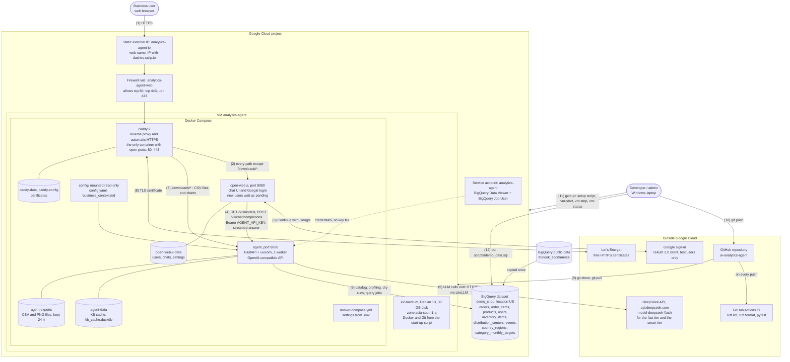

# High-Level Design (HLD)

The AI Analytics Agent answers questions about BigQuery data in plain English. A user chats in
Open WebUI. The agent finds the right tables, writes and checks the SQL, runs it on BigQuery and
answers with a short takeaway, a table, a CSV download, an optional chart and the SQL it ran.

Everything runs on one Google Compute Engine VM with Docker Compose: three containers (Caddy,
Open WebUI and the agent) behind one static IP address. The agent uses an LLM (DeepSeek, through
LiteLLM) and reads BigQuery with the VM's own service account.

For the inside of the agent (modules, classes, the request flow and the KB cache), see
[LLD.md](LLD.md).

## Architecture

## The numbered flows

| # | From → to | What happens |
|---|---|---|
| 1 | Browser → VM | The user opens the site over HTTPS. The static IP and the firewall rule let ports 80 and 443 in. |
| 2 | Caddy → Open WebUI | Caddy ends HTTPS and sends every path except `/downloads/*` to the chat UI. |
| 3 | Open WebUI ↔ Google | "Continue with Google". The redirect URI is `https://<domain>/oauth/google/callback`. New accounts start as **pending** until the admin approves them. |
| 4 | Open WebUI → agent | Open WebUI treats the agent as an OpenAI model named `analytics-agent`. It sends the whole chat to `/v1/chat/completions` with the shared key `AGENT_API_KEY` and shows the streamed reply. Open WebUI's own background LLM tasks (titles, tags, follow-ups) are turned off in `docker-compose.yml`. |
| 5 | Agent → DeepSeek | Every model call goes through LiteLLM: routing the question, picking tables, writing and fixing SQL, the takeaway, the chart spec, and the table summaries made at start-up. |
| 6 | Agent → BigQuery | The agent reads the table catalog (free), profiles a few columns, dry-runs every query, then runs it with a cap on the bytes billed. It uses the VM's service account, so no key file exists. |
| 7 | Caddy → agent | CSV downloads and chart PNGs are served by the agent at `/downloads/<random name>`. |
| 8 | Caddy ↔ Let's Encrypt | Caddy gets and renews the HTTPS certificate for the domain by itself. |
| 9 | GitHub → VM | The VM gets the code with `git clone`, and later `git pull`, then `docker compose up -d --build`. |
| 10 | Laptop → GitHub | The developer pushes changes. GitHub Actions runs the lint, format and test checks on every push. |
| 11 | Laptop → Google Cloud | `scripts/gcloud-setup.sh` creates the service account, IP, firewall rule and VM. `scripts/vm-start.cmd`, `vm-stop.cmd` and `vm-status.cmd` (or `scripts/vm.sh`) start, stop and check the VM. |
| 12 | Laptop → BigQuery | `scripts/demo_data.sql` copies Google's public TheLook shop data into `demo_shop` and adds two helper tables. |

## Components

| Component | Technology | Port | Stores | Job |
|---|---|---|---|---|
| Caddy | `caddy:2` | 80, 443 (public) | `caddy-data`, `caddy-config` | HTTPS, and routing to Open WebUI or the agent (`Caddyfile`) |
| Open WebUI | `ghcr.io/open-webui/open-webui:main` | 8080 (internal) | `open-webui-data` | Chat UI, user accounts, Google login, chat history |
| Agent | Python 3.12, FastAPI, uvicorn, this repo's `Dockerfile` | 8000 (internal) | `agent-data`, `agent-exports` | Understands the question, writes and runs SQL, builds the answer |
| KB cache | DuckDB file `data/kb_cache.duckdb` | – | `agent-data` volume | What the agent knows about each table: columns, summaries, sample values, business rules |
| LLM | DeepSeek `deepseek-flash`, via LiteLLM | HTTPS | – | Fast tier: routing, table picks, summaries, charts. Smart tier: SQL |
| Data | BigQuery, dataset `demo_shop` (US) | HTTPS | BigQuery storage | The data the agent answers questions about |
| VM | Compute Engine `e2-medium`, Debian 13 | – | 30 GB boot disk | Runs Docker Compose. A start-up script installed Docker and Git |
| Identity | Service account `analytics-agent` | – | – | Read tables (Data Viewer) and run queries (Job User), nothing else |

## Safety and cost controls

- **Read-only SQL, checked twice.** First offline with SQLGlot (`sql_guard.py`): one SELECT only,
  with no writes, locks, `INFORMATION_SCHEMA` or `EXTERNAL_QUERY`. Then BigQuery's dry run must say
  SELECT, read only allowed datasets and stay under the scan limit.
- **Cost caps.** `max_bytes_billed_gb` (50 GB) on every query job, a 120-second query timeout, at
  most 50,000 rows downloaded, and profiling capped at 1 GiB per table.
- **Least privilege.** The service account can read data and run jobs, nothing more. Only Caddy has
  open ports. The agent's API needs the `AGENT_API_KEY` bearer token.
- **Secrets stay out of git.** `.env`, `config/config.yaml` and `config/business_context.md` are in
  `.gitignore`.
- **Safe downloads.** Random 32-character file names, deleted after 24 hours. CSV cells that look
  like spreadsheet formulas are quoted.

## This deployment

| Item | Value |
|---|---|
| Project | `agentic-data-analytics-515910` |
| Region and zone | `asia-south1` (Mumbai), `asia-south1-a` |
| Static IP | `8.234.73.128` |
| Website | `https://8-234-73-128.sslip.io` |
| Models | `deepseek/deepseek-flash` (fast and smart) |
| Dataset | `demo_shop`, 9 tables, built by `scripts/demo_data.sql` |
