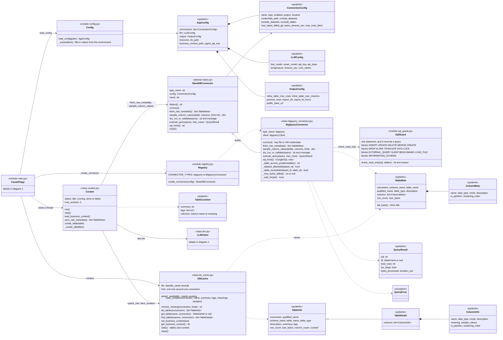
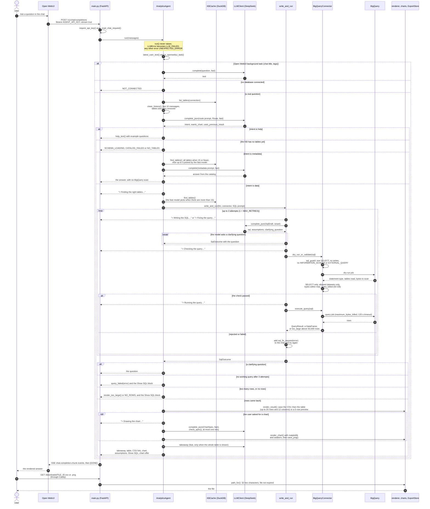
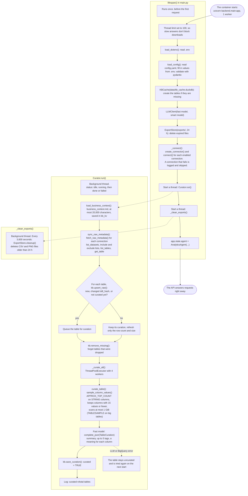
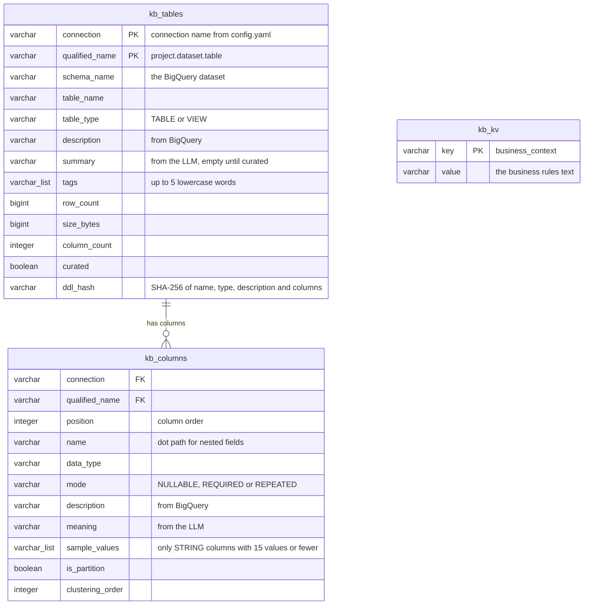

# Low-Level Design (LLD)

This is the inside of the `agent` container: every module in `backend/`, how a chat message
becomes an answer, what runs at start-up and what the KB cache stores. For the system around it
(Caddy, Open WebUI, Google Cloud, DeepSeek), see [HLD.md](HLD.md).

One picture with every function would be too small to read, so the design has five views:

1. [Classes: the request path](#1-classes-the-request-path): from the API to the answer.
2. [Classes: data access, KB cache and settings](#2-classes-data-access-kb-cache-and-settings):
   BigQuery, the start-up curation and the config.
3. [One chat request, step by step](#3-one-chat-request-step-by-step): the main flow.
4. [Start-up and background jobs](#4-start-up-and-background-jobs): what runs when the container starts.
5. [KB cache tables](#5-kb-cache-tables): the DuckDB file the agent keeps.

The [limits and constants](#limits-and-constants) table at the end lists every number in the code.

How to read the class diagrams: boxes marked `module` are Python files with functions only. A
solid arrow means "calls or owns", a dotted arrow "creates or returns", a hollow triangle
"inherits from" and a filled diamond "is made of". A box that says "details in diagram 1 / 2" is
shown in full in the other class diagram.

## 1. Classes: the request path

```mermaid
classDiagram
  direction LR

  class FastAPIApp {
    <<module main.py>>
    MODEL_ID: analytics-agent
    WORKER_THREADS: 100
    lifespan(app)
    require_api_key(request)
    health() GET /health
    list_models() GET /v1/models
    chat_completions(request) POST /v1/chat/completions
    get_download(file_name) GET /downloads/file
    _read_chat_request(request) messages and stream
    _sse_events(pieces) SSE chunks
    _connect(config) connectors by name
    _clean_exports(store, stop)
  }
  class AnalyticsAgent {
    <<class router.py>>
    MAX_TABLES_WITHOUT_PICK: 15
    MAX_PICKED_TABLES: 5
    connector: the first connected connector
    run(messages) Iterator~str~
    _answer(messages) Iterator~str~
    _help() str
    _no_tables_reply() str
    _pick_tables(tables, history, question) list~TableDetail~
    _metadata_answer(tables, history, question) str
    _data_answer(tables, route, messages, history, question) Iterator~str~
    _result_answer(outcome, wants_chart, question) Iterator~str~
    _takeaway(question, df) str
    _chart(df, question) str
    _chart_spec(df, question) ChartSpec
  }
  class Route {
    <<pydantic>>
    intent: metadata or data or help
    wants_chart: bool
    uses_previous_result: bool
  }
  class TablePick {
    <<pydantic>>
    tables: list~str~
  }
  class SqlWriter {
    <<module sql_writer.py>>
    MAX_RETRIES: 2
    write_and_run(llm, connector, chat) SqlOutcome
  }
  class SqlDraft {
    <<pydantic>>
    sql: str or null
    assumptions: list~str~
    clarifying_question: str or null
  }
  class SqlOutcome {
    <<dataclass>>
    sql: str
    assumptions: list~str~
    result: QueryResult or null
    clarifying_question: str
    error: str
  }
  class Prompts {
    <<module prompts.py>>
    ROUTE_SYSTEM, PICK_SYSTEM, METADATA_SYSTEM
    TAKEAWAY_SYSTEM, CHART_SYSTEM
    route_messages(tables, history, question)
    pick_messages(tables, business_context, history, question)
    metadata_messages(tables, all_tables, business_context, history, question)
    sql_messages(sql_hints, timezone, today, business_context, wants_chart, tables, previous_sql, history, question)
    sql_fix_request(error) str
    takeaway_messages(question, result_csv)
    chart_messages(question, df)
    chart_fix_request(problems) str
    table_names(tables) str
    catalog(tables) str
    table_details(tables) str
  }
  class History {
    <<module history.py>>
    latest_user_text(messages) str
    is_openwebui_task(text) bool
    clean_history(messages, max_messages=10) list~dict~
    last_sql(messages) str or null
  }
  class Replies {
    <<module replies.py>>
    NOT_CONNECTED, SCHEMA_LOADING, CATALOG_FAILED, NO_TABLES
    LLM_FAILED, UNEXPECTED_ERROR, NO_ROWS
    CHART_FAILED, CHART_OFFER
    help_text(tables) str
    which_table(tables) str
    query_failed(error) str
    rows_returned(count) str
  }
  class LLMClient {
    <<class llm.py>>
    litellm.drop_params: True
    model_for(tier) model name
    complete(messages, tier) str
    complete_json(messages, schema, tier) pydantic model
  }
  class LLMError {
    <<exception>>
  }
  class Renderer {
    <<module renderer.py>>
    render_result(df, total_rows, store, output, timezone) RenderedResult
    render_sql_block(sql) str
    render_assumptions(assumptions) str
    render_too_large(total_rows, max_rows) str
    format_cell(value, column_name, timezone) str
    df_to_markdown(df) str
  }
  class RenderedResult {
    <<pydantic>>
    markdown: str
    inline: bool
    csv_file: str
  }
  class Charts {
    <<module charts.py>>
    chart types: bar line scatter hist box heatmap pie
    check_spec(spec, df) list~str~
    render_chart(df, spec) PNG bytes
  }
  class ChartSpec {
    <<pydantic>>
    chart_type, x_col, y_col, hue_col, value_col
    title, x_label, y_label
    horizontal, top_n, sort
  }
  class ExportStore {
    <<class exports.py>>
    export_dir: exports
    ttl_hours: 24
    save_csv(df) file name
    save_png(data) file name
    url_for(file_name) str
    path_for(file_name) path or null
    cleanup() int
  }
  class KBCache {
    <<class kb_cache.py>>
    details in diagram 2
  }
  class BaseDBConnector {
    <<abstract base.py>>
    details in diagram 2
  }
  class QueryResult {
    <<pydantic>>
    details in diagram 2
  }

  FastAPIApp --> AnalyticsAgent : run(messages)
  FastAPIApp --> ExportStore : path_for, for downloads
  AnalyticsAgent --> History
  AnalyticsAgent --> Prompts
  AnalyticsAgent --> Replies
  AnalyticsAgent --> KBCache : list_tables, find_tables
  AnalyticsAgent --> LLMClient : fast tier
  AnalyticsAgent --> SqlWriter : write_and_run
  AnalyticsAgent --> Renderer
  AnalyticsAgent --> Charts
  AnalyticsAgent --> ExportStore : save_png
  AnalyticsAgent ..> Route
  AnalyticsAgent ..> TablePick
  SqlWriter --> LLMClient : smart tier
  SqlWriter --> BaseDBConnector : dry run, execute
  SqlWriter ..> SqlDraft
  SqlWriter ..> SqlOutcome
  SqlOutcome --> QueryResult
  LLMClient ..> LLMError
  Renderer --> ExportStore : save_csv
  Renderer ..> RenderedResult
  Charts ..> ChartSpec
  Prompts --> Renderer : df_to_markdown
  Replies --> Prompts : short_name, summary_line
```

## 2. Classes: data access, KB cache and settings

## 3. One chat request, step by step

A data question with every branch. The `> …` lines are progress lines the user sees while the
agent works.

## 4. Start-up and background jobs

Because `upsert_raw` compares a hash of each table's structure, a restart re-curates only new or
changed tables. An unchanged project costs no profiling and no LLM calls.

## 5. KB cache tables

The KB cache is one DuckDB file on the `agent-data` volume. It is only a cache: deleting it costs
one full curation pass on the next start.

## Limits and constants

| Where | Name | Value | What it does |
|---|---|---|---|
| `main.py` | `WORKER_THREADS` | 100 | Worker threads, so slow answers don't block downloads |
| `main.py` | `EXPORT_CLEANUP_INTERVAL_SEC` | 3,600 | How often expired downloads are deleted |
| `router.py` | `MAX_TABLES_WITHOUT_PICK` | 15 | Up to this many tables, the model sees all of them |
| `router.py` | `MAX_PICKED_TABLES` | 5 | Most tables picked for one question |
| `sql_writer.py` | `MAX_RETRIES` | 2 | Extra tries after a rejected query (3 attempts in all) |
| `history.py` | `max_messages` | 10 | Earlier chat messages sent to the models |
| `prompts.py` | `MAX_ROUTER_TABLE_NAMES` | 150 | More tables than this: the router sees dataset counts instead |
| `prompts.py` | `MAX_CATALOG_CHARS` | 30,000 | Size limit of the one-line catalog |
| `prompts.py` | `MAX_SUMMARY_CHARS` | 300 | Longest table summary line |
| `prompts.py` | `CHART_SAMPLE_ROWS` | 5 | Rows the chart model sees |
| `curator.py` | `max_workers` | 4 | Tables curated at the same time |
| `curator.py` | `MAX_PROMPT_COLUMNS` | 150 | Columns per table sent to the model |
| `curator.py` | `MAX_BUSINESS_CONTEXT_CHARS` | 20,000 | Longest business context used |
| `curator.py` | `MAX_TAGS` | 5 | Tags kept per table |
| `bigquery_connector.py` | `_PROFILE_MAX_BYTES_BILLED` | 1 GiB | Scan cap for profiling one table |
| `base.py` | `sample_column_values(limit)` | 15 | Most distinct values kept as samples |
| `replies.py` | `MAX_LISTED_TABLES` | 25 | Tables listed when the agent asks which one to use |
| `charts.py` | `MAX_BARS`, `PIE_SLICES` | 30, 8 | Most bars, and pie slices before "Other" |
| `config.yaml` | `max_bytes_billed_gb` | 50 | Scan cap per query (dry run and job) |
| `config.yaml` | `query_timeout_sec` | 120 | A query running longer is cancelled |
| `config.yaml` | `max_rows_fetch` | 50,000 | More rows: counted, not downloaded |
| `config.yaml` | `inline_table_max_rows`, `inline_table_max_columns` | 20, 12 | Bigger results show a preview instead |
| `config.yaml` | `preview_rows` | 5 | Rows in a preview |
| `config.yaml` | `export_ttl_hours` | 24 | How long CSV and PNG files are kept |
| `config.py` | `LLMConfig` | temperature 0, timeout 120 s, 2 retries | Settings for every model call |
